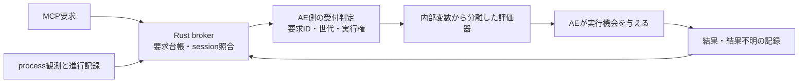

# AE2025 bridgeの仕様・設計監査（2026-10-26）

対象はAE2025（25.6.6x4）用bridge。ユーザーの依頼により、仕様、AE内runtime、外部brokerの3系統で並列監査した。今回はAEを起動せず、Adobe一次資料・既存コード・過去の実機証跡と、隔離した故障注入試験を使用した。

**結論は、待ち時間の調整を続けるだけでは解消しない、実行管理と状態管理の設計上の問題が複数ある、というものである。** AEの待機、ファイル通信の故障、予約処理の停止、未完了要求を同じ「接続異常」として扱い、再初期化で解決しようとする場面がある。さらに、実行するJSXと内部管理変数の境界、要求を1回だけ実行するための確定処理にも欠落がある。

これは全過去事故の直接原因を特定したという意味ではない。今回再現した条件付き故障と、実事故の記録から分かることを以下で区別する。

## 1. 仕様から見直すべき前提

| 前提 | 根拠と判断 |
|---|---|
| AE内のwatchdogは命令受信と独立して動ける | AdobeのCEP資料はhost ExtendScriptがmain threadで動くことを説明する。今回までのAE2025実測でも3種類のcallbackと観測scriptがまとめて待たされた。監視を増やしても独立した実行機構にはならない |
| heartbeatが10〜20秒古ければhostの故障を確定できる | 長い同期処理・dialog待ちでも同じ観測になる。公開資料から最大待ち時間・実行順・deadlineの保証は得られない。staleは「最近の進行を確認できない」であり、「processが消えた」「予約を失った」の証明ではない |
| named target engineやIIFEで実行環境を隔離できる | Adobeの古いTools Guideは#targetengineの対応をIllustrator/InDesignと記載し、他hostでは無視すると説明する。AE2025のmain実測とも整合。IIFEは名前空間を分けても実行threadや中断の影響を分けない |
| AfterFX -rで外から確実に復旧できる | Adobe Helpの説明は既存instanceでscriptを実行すること。PID直接指定・実行期限・modal回避の保証ではない。現在のinstance/runtime再照合は必要だが、AE側の実行可能性は保証しない |
| Esc試験を通れば中断後のfinallyも保証できる | Adobe HelpはEscでscript停止を説明するが、中断時のfinallyと予約処理の契約までは示していない。前回の試験は通常完了であり、異常中断耐性の確認にはなっていない |

一次資料: [Adobe CEP 12 Cookbook](https://github.com/Adobe-CEP/CEP-Resources/blob/master/CEP_12.x/Documentation/CEP%2012%20HTML%20Extension%20Cookbook.md#invoke-point-products-scripts-from-html-extension)、[Adobe JavaScript Tools Guide CC（235ページ）](https://github.com/Adobe-CEP/CEP-Resources/blob/master/ExtendScript-Toolkit/Guides/JavaScript%20Tools%20Guide%20CC.pdf)、[Adobe Help: Scripts](https://helpx.adobe.com/after-effects/desktop/automate-in-after-effects/automate-animation/scripts.html)。Tools Guideは古い原典であり、現行AE全版の追加保証として扱わない。Adobe Helpが参照するdocsforadobeのAPIリファレンスは独立編集資料で、Adobe一次資料とは区別した。

前回の「復帰後3秒猶予」は、実際に再現した誤判定を改善する候補である。ただしAEが3秒以内に再開するという仕様保証はなく、これを根本解決の契約にはできない。

## 2. コードで確認し、隔離試験で再現した問題

行番号は今回のworktreeのもの。runtimeは `src/scripts/mcp-bridge-auto.jsx`、外部側は `crates/bridge-core/src/lib.rs` と `crates/daemon-core/src/`。

| 問題 | 確認した結果 | 主な根拠 |
|---|---|---|
| 実行開始の状態書込が失敗しても命令を実行する | command statusの書込だけ故障させると、同じrequestが6秒で3回実行された。mailboxはpending、結果はsuccess | runtime 3900行・3980行。書込失敗を握り潰し、成功確認なしでexecuteCommandへ進む |
| raw JSXが内部管理変数へ到達する | direct evalに渡した `heartbeatTickActive = true;` で内部状態が変わり、要求完了後もcallbackActive=trueが60秒以上残った。Node VMとWindows JScript ES3で確認 | runtime 3542行。小さなIIFEの内側でも、外側runtimeの変数を参照できる |
| callbackの例外保護が開始処理を覆っていない | engine名のString変換に1回だけ例外を注入すると、commandTickActiveが残った。変換を正常へ戻しても60秒後に命令受信は再開せず、healthy=trueのまま | runtime 4275〜4278行。active設定とmetadata取得がtry/finallyより前。heartbeat側も同形 |
| 復旧条件が入口ごとに異なる | panel等のensureHealthy入口は前回のwatchdog猶予を迂回。public restartはlive render=trueでもruntimeを更新 | runtime 4340行、4415行、4463行 |
| ファイル書込不能をscheduler停止と取り違える | heartbeat書込だけを故障させると、callbackが進んでいるのに60秒で16回再初期化 | runtimeのhealth判定とheartbeat-writeエラー。再初期化しても書込不能は直らない |
| 未完了要求が自動復旧の入口を塞ぐ | 実native wrapperでは、全予約を失った後、idleのみ復旧。pending・予約ありは復旧拒否のまま。抽出した実schedulerでも未完了workerが復旧と別instanceのglobalExclusiveを塞いだ | daemon lib.rs 580行の無期限待ち、ae_recovery.rs 62行、ae_recovery.jsx 15行 |
| 古い直接書込入口が排他を迂回できる | legacy toolはrequest IDなしで同じmailboxへ直接上書きするコード経路を持つ。現行public run-jsxは通常通らない | bridge-core 282行。これは静的確認で、実事故での利用は未確認 |

brokerは成功resultを得るとregistryを完了にし予約を消すが、pendingのまま残ったcommandの再実行をAE側で防ぐ仕組みにはなっていない（bridge-core 775〜790行・1130行）。したがって「送信側では同じ要求を再送しない」だけでは十分ではない。

無期限待ちには、timeout後に制作処理を重複実行しないという妥当な目的がある。ただし「結果不明の記録を保持する」と「workerや全体の排他権を永久に保持する」は別の責務である。結果待ちloopにprocess終了の確認は見当たらず、既知の旧process終了後にも資源を保持し続ける経路が残る。process終了そのものは今回実機で注入していない。

また、現在のpendingは未実行の証明にならない。上記のstatus書込失敗で実行済みでもpendingが残るため、期限だけでpendingを消して再送する修正は適切ではない。

## 3. 過去の「約21分の処理中滞留」について、今回絞れたこと

10月24日の `temp/ae2025-recurrence-20261024/native-refused-busy.json` は次の状態だった。

- commandTaskId=0、tasksScheduled=true、callbackActive=true、currentRequestId=null。
- commandTickSequence=171。到着時heartbeatは170。
- commandPollSequenceは両方11080、lastCommandPollAtも同じ。

runtime 4125行の式 `(!!commandCheckerTaskId || commandTickActive) && ...` から、**この記録ではcommandTickActive=trueが残っていたと推論できる**。前回の「どの内部フラグか分からない」から一段絞れた。

次の命令callback入口には入り、poll更新まで進まなかった、またはその間に異常脱出した可能性がある。この範囲にはtry前のmetadata取得と、checkForCommands冒頭のrefreshDebugLogConfigも含まれる。正確な停止行やAE内部の中断条件は不明。

今回のString変換故障注入は、同じ種類のフラグ滞留がコード上起こり得ることを示す。実事故でStringが壊れていたことを示すものではない。限定した過去証跡からraw JSXの同名代入も見つかっておらず、他pluginや特定の制作scriptを原因と断定しない。

## 4. 提案する設計と修正順序

### 優先1: 実行境界と重複実行の防止

- 内部runtimeのクロージャを、raw JSXの実行環境として渡さない。独立した字句スコープの評価器へ、argsとmcp等の公開APIだけを渡す。
- Functionベースの評価器をメモリ内だけで比較したところ、Node VM・ES3とも同じ代入がprivate flagへ届かなくなった。args、mcp.log、結果の受渡しも小さい試験で確認した。これはsandboxではなく、内部変数の偶発的な捕捉を防ぐ変更案。全機能の互換確認は未実施。
- requestを実行すると決めた記録の永続化が成功してから実行する。実行済み／結果不明のrequestを再度実行しない台帳を設け、結果書込失敗でも自動でやり直さない。
- active設定から終了までをtry/finallyで覆い、診断用metadata取得の失敗も記録する。異常なbusyを無条件にhealthyと扱わない。

### 優先2: 状態と復旧方針の分離

次の5項目を別々に管理する。

| 項目 | 例 |
|---|---|
| host sessionの存在 | process存続／終了／照合不能 |
| 通信の状態 | ファイル読書可能／I/O失敗 |
| AE内の実行状態 | 実行中／実行機会待ち／現在は不明 |
| 要求の段階 | queued／dispatched／claimed／executing／finished／outcome unknown |
| 直近の進行 | 各callbackの開始・完了・再予約時刻と世代 |

heartbeatが古くなっただけでsessionを消滅扱いにしない。生きているprocessが実行可能とは限らず、fresh heartbeatだけで命令受信が進むとも限らない。

watchdog、Startup再評価、panel refresh、manual restart、native recoveryが、同じ状態遷移判定を通るようにする。状態照会は原則として観測だけにし、panelを開いたことで暗黙にruntimeを捨てない。I/O故障にscheduler再起動を繰り返さない。

### 優先3: 要求・session・復旧の通信契約を整理

request IDに加えhost sessionと世代を照合し、古い世代の遅延要求が新しいsessionで実行されないようにする。OS processの開始時刻とruntimeの生成時刻を同一視しない。正しいprocessとの対応が確認できない場合は、推測で対象を選ばない。

未完了要求があっても状態照会・復旧可否の判定をできる制御経路を設ける。ただし制作命令の実行を追い越して再初期化する許可にはしない。未実行取消はhost側の受付と競合しない確認付きの手順にする。

既知のprocess終了では、結果不明の記録を残しつつ旧workerと排他権を解放する。新sessionへ自動再送せず、遅延結果は元のrequestへ結び付けて保存する。legacy入口も同じbrokerへ統合するか拒否する。

### 優先4: 配布を一つの検証済み版にまとめる

同じ0.5.4表記でも候補と導入版は異なる。installerは同版番号でhashが違うruntimeをローカル改変として保持する条件を持つ（scripts/install-bridge-installer.ps1 1808行）。今回の候補を正式導入する際は版番号とbuild identityを更新し、runtime／Startup／Shutdown／native wrapperの互換性をまとめて確認する。これは更新が残る条件のコード確認であり、過去の導入失敗ログを新しく発見したという意味ではない。

## 5. CEP・UXP・nativeへの置換をどう考えるか

| 方式 | 今回の判断 |
|---|---|
| 現方式のExtendScript＋Rust | 上記の実行境界・台帳・状態分離は直ちに設計できる。AE2025を維持する当面の改修対象 |
| CEP | 通信・UI側の寿命を分ける比較候補。ただしDOM実行はhost main threadへ渡るので、AE占有中の実行保証にはならない。公式Invisible sampleにはAEFTがあり、従来ADRで表の不掲載だけを強く根拠にした点は見直す |
| UXP | 公式AE API資料は既にあるが、確認したApplication APIは27.0以降。AE2025への即時置換案にしない |
| native AEGP | native側で受付・session・寿命管理を持つ比較候補。SDK原本の該当契約とAE2025での受入試験が必要。今回SDK原本を取得できておらず、常時実行可能・必ず復旧可能とは判断しない |

CEPの一次資料は、[Cookbook](https://github.com/Adobe-CEP/CEP-Resources/blob/master/CEP_12.x/Documentation/CEP%2012%20HTML%20Extension%20Cookbook.md)のInvisible対応表と[Samples README](https://github.com/Adobe-CEP/Samples)の記載が一致していない。[CEP12の実manifest](https://raw.githubusercontent.com/Adobe-CEP/CEP-Resources/master/CEP_12.x/Samples/CEP_HTML_Invisible_Extension-12.0/CSXS/manifest.xml)にもAEFT・Custom・AutoVisible=falseがある。一方、記載のStartOnにはAE2025でのcold-start発火保証がない。「AEは不可視CEP非対応」とも「panelなし起動が保証済み」とも断定せず、最小PoCで再評価する余地がある。

[Adobe UXP Application](https://developer.adobe.com/after-effects/uxp/after-effects-api/application)は対象APIを27.0以降と記載する。[Adobeの移行方針](https://blog.developer.adobe.com/en/publish/2026/09/investing-in-the-future-of-creative-cloud-extensibility-uxp-comes-to-our-flagship-applications)はAE UXP public betaを2026年11月予定とし、ExtendScriptはCEP移行の影響外としている。2026年10月26日時点の情報であり、将来の方針とAE2025の現行対応を混同しない。

**現時点の提案は、通信方式の全面置換を先に決めることではなく、どの方式でも必要な実行・状態管理の契約を先に直すこと。** CEP／nativeの比較は、その契約を満たすhost側adapterとして評価する。

## 6. 次の改修の合格条件

- 長いhost待ちとI/O故障だけを理由にruntimeの再初期化を繰り返さない。
- 状態書込失敗・結果書込失敗・同一request再到着で、制作操作を重複実行しない。実行済みか不明なものは不明と返す。
- raw JSXから内部管理変数を偶発的に捕捉しない。args／mcp／既存result型の互換性を確認する。
- 各callbackの入口・終了・再予約で例外を注入し、正常な例外ではactive状態を片付ける。実AEの強制中断は別途検証する。
- pending要求中の予約消失、既知のAE終了、再起動、新旧sessionの遅延結果で、未解決要求の記録とworker解放を両立する。
- すべての復旧入口・互換tool入口に同じ制約が適用される。
- 通常起動、file dialog、実レンダー、長いscript、再起動後、長時間使用でAE2025の実機受入を行う。

既存の19件等の成功は、その試験条件での成功である。従来fixtureは規則的なtask順序、正常な組込関数、通常のfinally、正常なfile I/Oを主に与えていた。今回の故障注入で不足を補ったが、Node VMやWindows JScriptはAE内部の実行系を再現するものではない。

## 証跡・作業範囲

- runtime側: `temp/ae-spec-audit-20261026/runtime/`。7ケースのVM比較、実executeJsx抽出を使ったES3比較、README。
- 外部側: `temp/ae-spec-audit-20261026/broker/`。実wrapperの4条件、実scheduler／permit抽出の小さいRust試験、所見。
- 既存のAE2025実機比較は[前回の検証報告](ae2025-root-cause-verification-2026-10-25.md)。
- 今回は既存runtime・Rust製品コードを変更していない。runtime hashは前回と同じ `E684673AB2E6BB92EEC3D80F17C2133F74E27AD269DC077423250117C812C1B2`。
- AE・常駐MCP・設定・制作AEPへ介入せず、pluginも導入していない。監査用exe/PDBは削除済み。再現scriptとテキスト証跡だけを当該worktree内へ残し、常駐処理や自動実行は追加していない。
