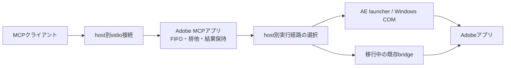

# Adobeアプリのbridgeを不要にする移行案

更新日: 2026-10-13。調査の基準はベータ版0.5.3（`91d2b1c`）。本書は実機で確認した事実と、今後実装する仕様案をまとめる。native経路は基準コミットでは製品に未実装である。

## 目的と今回の優先順位

Adobe MCPアプリがAdobeアプリの起動状態を把握し、利用者が専用パネルを開く、ドックする、受信ボタンを押すといった操作なしにスクリプトを実行できるようにする。可能なhostではAdobe側への独自bridgeのインストールも不要にする。

当初は[公開Toolの整理](public-tool-surface-plan.md)を先に進める方針だった。2026-10-13の依頼により、現在の優先順位は次のとおり。

1. AEの「ドックしているのに未接続のまま」の原因調査と根本修正をrender PCで行う。
2. bridgeの安定した復旧が難しい場合は、AEだけnative経路の実装を先行する。
3. 公開Toolの整理を進め、Photoshop／Illustratorを段階的に移行する。
4. Premiereは現在のUXP bridgeを継続する。InDesignの移行は別途判断する。

現行PCの制作環境への適用と、別PCでの開発・試験は分ける。今回の修正・調査の結論は[AE接続調査](after-effects-connection-investigation.md)を参照する。

## 「bridgeなし」の範囲

なくす対象はAdobe側に常駐する独自のStartup／ScriptUI／CEP／UXP受信プログラムである。次の構成要素は引き続き必要になる。

- Adobe MCPアプリ内のbroker、FIFO、排他制御、request registry。
- スクリプトをAdobeへ渡し、結果を回収するhost別の実行経路。
- 実行ごとのwrapper、必要に応じた一時JSXと結果ファイル。

JSON自体の廃止は目的ではない。native AEのPoCも要求ごとに結果JSONを書き出している。常駐bridgeが共有command fileを定期監視する構成と、1回のnative呼び出しに対応する結果ファイルは区別する。

## 2026-10-09の実機調査結果

Windowsの既存環境で、追加ソフトウェアを入れずに調べた。独自bridgeはインストールされたままなので、「bridgeを経由しない呼び出し」の成立を確認した段階であり、未導入のクリーン環境での保証ではない。

| アプリ | 確認した版・経路 | 結果と制約 | 移行方針 |
|---|---|---|---|
| After Effects | 2025 / 25.6.6x4、`AfterFX.com -r` | 通常起動したAEへJSXを渡し、同じプロセスからnonce・計算結果を回収。初期の`AfterFX.exe -r`では結果を回収できなかった。cold startは未確認 | Windowsで最初の候補。今回の障害修正が困難な場合に先行 |
| Photoshop | 26.11.7、Windows COMからJSX | version、計算結果、document数を取得。UXPではなくExtendScript | 次段階。既存UXPコードとの互換を明示 |
| Illustrator | 29.8.10、Windows COMからJSX | version、計算結果、document数を取得 | 次段階。CEPを必須にしない構成へ |
| InDesign | 21.4.1.4、COM `DoScript` | JSXとUXPの直接実行を確認 | 現行Startupを維持し、移行は別タスク |
| Premiere Pro | 25.6.6、`/C es.processFile` | cold startでは成功、起動済みへの送信では未完了。サポートされた製品経路としては採用しない | 現行UXP＋WebSocketを維持 |
| Premiere Pro | AEからのBridgeTalk | 結果の往復は成功。ただし別Adobeアプリに依存 | 通常経路には採用しない |

AE 2026は当時の互換性警告で検証を保留した。2025の結果から2026対応を保証しない。Photoshop／Premiereの既存UXPについては、ロード済みならパネルのボタン操作なしで受信できることも確認した。

調査元は当時の作業checkoutの`temp/native-probe-2026-10-09/verification-summary.json`と対応するnonce付き結果ファイル。これらはGit管理外の実機資料である。長期的な保証は、製品用fixtureと再現手順を追加して確立する。

未確認事項: bridge未導入PC、macOS、同時に起動した複数version／複数instanceの選択、制作データの編集・export、modal／sleep／強制終了／長時間処理、インストーラー更新後の復旧。

### 2026-10-13のrender PC追加検証

AE2025 `25.6.6x4`の対話Session 1では、公式に案内される`AfterFX.exe -r`でも既起動プロセスからnonceと空プロジェクトの情報を回収できた。SSH Session 0からの試行は応答を回収できず、同じPCでも実行sessionと起動完了状態を区別する必要がある。

modal中のnative実行はAEに拒否された。一方、旧bridgeのすべての定期処理が進まない状態でも、modal解消後のnative読み取りと、新規に予約した定期処理は動作した。native経路がschedulerへの依存を減らす根拠にはなるが、AE自身のmodalやhangを迂回する保証にはならない。

bridgeの修正では、command／heartbeatだけの停止をパネル操作なしで回復し、14秒の処理も一度だけ完了した。全callback停止への対策と実ドック状態の受入確認は残る。詳細・証跡は[AE接続調査](after-effects-connection-investigation.md)を参照する。

## 共通実行契約

`run-script`等の公開Toolはtransportの選択から独立させる。既存の[script contract](script-contract.md)を引き継ぐ。

- 要求受付時に対象host、version、instance、runtime、transportを確定する。
- nativeとbridgeの両方が存在しても、同じAdobe instanceへ二重配送しない。
- `requestId`、source hash、入力、監査情報、待機上限、結果保持を共通化する。
- 受付順序とinstance単位の排他を、native側にも適用する。
- timeoutはクライアントの待機終了であり、Adobe内の実行停止ではない。
- 配送後の成否が不明なら`unknown`を保持し、別経路へ再送しない。
- キュー内cancelは実行を防ぐ。配送後の強制停止は保証しない。

### 対象の発見と選択

インストール済みと起動済みを別々に列挙する。可能な場合は実行ファイルの絶対パス、version、PID、プロセス開始時刻を識別に使う。PIDだけを永続識別子にしない。

OS上でプロセスが見つかることと、スクリプトを受け付けられることは別状態とする。列挙や`get-capabilities`のためにアプリを勝手に起動しない。

COMの登録名やAE launcherが要求先を一意に指定できない環境では、対象を黙って選ばず曖昧な状態を返す。最初の対応範囲を「対応versionを1つ起動」に限定してもよい。複数version対応は、応答したhostのversionと要求の照合、誤配送を防ぐ実機試験が通ってから有効にする。

### 状態の分離

内部では少なくとも以下を分け、UIには利用者が判断できる短い説明を出す。名称は実装時に既存fieldとの互換を調整する。

| 状態 | 意味 |
|---|---|
| 未起動 | 対象のAdobeプロセスが見つからない |
| 起動中・未確認 | プロセスはあるが、そのsessionで実行可否をまだ確認していない |
| 利用可能 | 対象と実行経路を確認し、未解決の実行がない |
| 処理中 | 既知の要求を配送済み。生存確認が遅れても終了扱いにしない |
| 応答確認待ち | 処理完了や応答を確認できない。新しい要求の安全な配送は保証しない |
| 経路の障害 | launcher、COM、bridge等の受信経路に問題がある |

2026-10-13には、約7分のAE処理中にheartbeatが停止し、同じruntimeのまま完了後に復帰する現象を確認した。native化してもAE自身の同期処理・modalによる待ち時間は残る。heartbeatの見え方を変えるだけで「常に操作可能」と表示しない。

## host別の仕様案

### After Effects

Windowsでは`AfterFX.exe -r`を専用adapterの第一候補とし、過去に成功した`AfterFX.com -r`も対応version別に評価する。要求受付時にlauncherを決定し、応答がないからといって別launcherへ同じコードを再送しない。`-m`による別instance起動や、別versionへの自動配送は既定で行わない。起動済みへの配送を先に成立させ、起動操作の製品化は別に試験する。

Adobeの[Scripts公式説明](https://helpx.adobe.com/after-effects/desktop/automate-in-after-effects/automate-animation/scripts.html)は`afterfx.exe -r`で既存instanceへ実行する経路を案内している（2026-10-13確認）。10月9日のPoCでは`.com`、10月13日のrender対話sessionでは`.exe`が成功した。異なるlauncher・実行session・起動状態の結果を同一条件の成功としてまとめない。

1. Rust側で要求を記録し、要求専用ディレクトリへwrapper JSXと必要な入力を用意する。
2. wrapperはnative実行だけで完結し、`ae_command.json`や既存bridgeのglobal関数に依存しない。
3. `requestId`・nonce・host versionを付けた結果または例外を保存する。
4. Rust側で対応関係とサイズを検証して結果をregistryへ取り込み、待機中のclientへ返す。
5. launcher終了コードだけでは実行成功としない。結果が不明な場合は要求を保持する。

ファイルは所有するtask/requestディレクトリ内に限定し、衝突しない名前、canonical path、適切なACL、結果の原子的な公開を使う。要求が未解決の間は削除しない。cleanupは所有と保持期限を確認して行う。

Undoは既存ユーザースクリプトが自身でgroupを管理する場合を含めて確認する。現行PCのruntimeにはUndoに関する個別修正が残っているため、配布時に単純上書きしない。

### Photoshop

Windows COMで動かしたJSXと、現在のUXP bridgeで動くコードは同じ言語環境ではない。`require('photoshop')`、`batchPlay`、`executeAsModal`を使うUXPコードを、黙ってExtendScriptへ流さない。

`runtime`を明示的に選べる契約とし、既存UXP要求は既存bridgeを使う。native対応はExtendScriptから開始する。UXPのみで可能な操作はbridgeを残す理由になるため、新規インストールでもUXPを任意componentとして選べる設計を検討する。

### Illustrator

Windows COMからExtendScriptへ送るadapterを実装する。通常の新規導入でCEPを必須にしない。複数version、文書を開いた状態、export、例外、Undoと再起動後の再接続を検証する。

### Premiere／InDesign／macOS

Premiereは現在のUXPとWebSocketを継続する。他アプリの起動に依存するBridgeTalkや未保証の起動引数を標準化しない。InDesignは実機PoCの成功を記録するにとどめ、今回の移行対象を増やさない。

Windows COMと`AfterFX.com`の成果をmacOSへ適用しない。macOS adapterは独立した調査・実機試験が必要であり、その完了までは従来経路を維持する。

## インストールと段階移行

| 場面 | 推奨する挙動 |
|---|---|
| 対応済みWindows hostの新規導入 | 検証を通過したhostだけnativeを既定にし、そのhostのbridgeを自動導入しない |
| AEだけ先行した版 | AEのみ上記を適用。PS／AIを未対応のまま省略しない |
| 既存ユーザーの更新 | 既存bridgeを直ちに削除せず、nativeへの切替を段階的に行う |
| native経路の事前確認失敗 | 配送前なら明示された互換設定に従って既存経路を選択できる |
| 配送後のtimeout／切断 | 自動fallback・再実行をせず、同じrequestIdの結果を待つ |
| bridgeの撤去 | 未解決要求がないこと、ファイル所有、現地改変、rollback手段を確認してから実施 |

MSIのcomponent選択だけでなく、`scripts/install-desktop-integration.ps1`の後処理も修正する。現状はPS／PR／IDのインストール関数やAIのコピーが後処理から呼ばれるため、片方だけ変えると省略したbridgeが再配置される。

修復インストール、更新、アンインストールでも選択を保存する。改変済みbridgeはhashを確認して保全し、利用者の設定・作品ファイルを削除しない。native利用中の旧bridgeは受信経路として選択しないようbroker側で調整する。

## 実装の分割と受入条件

| 段階 | 成果物 | 次へ進む条件 |
|---|---|---|
| 0 | AE接続障害の修正と調査記録 | 処理中の誤判定と本当の停止を区別。実行を重複させない |
| 1 | 実行adapterと状態モデル | 既存bridgeのFIFO・結果保持・cancelを壊さない |
| 2 | AE native adapter | AE2025でbridgeを使わない配送・回収・例外・長時間・再起動を確認 |
| 3 | 新規導入と更新の選択 | bridge未導入環境と旧版からの更新を両方確認 |
| 4 | PS／AI adapter | runtime差とversion選択、編集・exportを実機確認 |
| 5 | macOSと追加host | 個別の実機matrixを完了してから対応を宣言 |

AEの必須試験は、パネルなし／ドックあり／閉じた状態、短いnonce付き実行、10秒を超える処理、modal、通常例外、利用者による中断、AE終了、broker再起動、未回収結果、同名の旧bridge残存、対象version曖昧時の拒否。native化後はbridgeを物理的に導入していない状態でも試す。

テスト用の空プロジェクトを使用し、制作データをfixtureにしない。mockの合格と実機の合格を分けて記録する。これらが通るまでは、単発PoCを理由に全hostのbridgeを省略しない。
